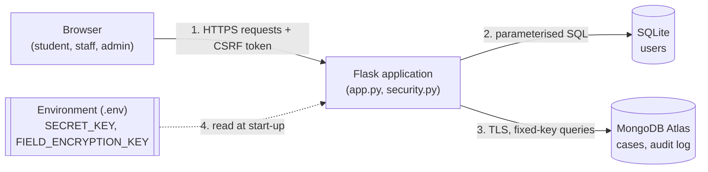

# Threat model (STRIDE) and trust boundaries

## Data flow diagram

## Trust boundaries
| ID | Boundary | Why it matters | Controls |
|---|---|---|---|
| TB1 | Browser to application (the internet) | Everything from the browser is untrusted | Whitelist validation, CSRF tokens, escaping, session cookie flags, security headers, size limit |
| TB2 | Role boundary inside the application | A student, staff member and admin trust each other differently | `roles_required` on every route, owner id in queries, admin has no content route |
| TB3 | Application to SQLite | Holds credentials | Parameterised SQL, Argon2id hashes, file kept out of Git |
| TB4 | Application to MongoDB Atlas | Holds sensitive cases over a network | TLS with verified certificates (certifi), fixed-key queries, encrypted fields, restricted Atlas network access and user |
| TB5 | Application to its environment | Secrets decide whether encryption is worth anything | Secrets only in `.env`, app refuses to start without them, `.env` in `.gitignore` |

## STRIDE analysis and traceability
Each row traces: scenario need (BR) -> threat -> mitigation (SR) -> code -> test.

| ID | STRIDE | Threat | BR | Mitigation (SR) | Code | Test |
|---|---|---|---|---|---|---|
| T1 | Spoofing | Password guessing / brute force | BR1 | Lockout after 5 failures, 15 min (SR2); Argon2id (SR1) | `authenticate`, `record_failed_login` | `test_account_locks_after_repeated_failures_then_unlocks` |
| T2 | Spoofing | Finding which emails have accounts | BR1 | Same error for every failure; dummy hash check for unknown emails (SR2) | `authenticate` | `test_wrong_password_and_unknown_email_give_same_message` |
| T3 | Spoofing | Session fixation or a still-valid session after an account is disabled | BR10 | New session at login; HttpOnly + SameSite; 30 min expiry; user re-checked every request (SR3) | `login`, `load_current_user` | `test_session_cookie_flags`, `test_disabled_account_cannot_log_in_and_is_signed_out` |
| T4 | Spoofing | Forged request from another site (CSRF) | BR2, BR4, BR6 | CSRF token on every POST; POST-only logout (SR7) | `CSRFProtect` | `test_csrf_is_enforced_when_enabled`, `test_logout_requires_post_and_ends_session` |
| T5 | Tampering | SQL injection | all | Parameterised SQL, validation (SR5, SR13) | `database.py` | `test_sql_injection_in_login_fails_safely` |
| T6 | Tampering | NoSQL injection via URLs or filters | BR5 | Fixed-key queries; filters checked against whitelists (SR5, SR13) | `staff_queue`, `load_own_case` | `test_other_students_cannot_open_the_case`, `test_staff_queue_filters_and_priority_order` |
| T7 | Tampering | Changing another student's case (IDOR) | BR3, BR4 | Owner id inside every student query; 404 not 403 (SR4) | `load_own_case`, `withdraw_case` | `test_other_students_cannot_open_the_case` |
| T8 | Tampering | Editing a case after staff started on it | BR4 | Update filter includes status *New*; delete is archive (SR9) | `edit_case`, `withdraw_case` | `test_student_can_edit_while_new_but_not_after`, `test_student_can_withdraw_while_new_but_not_after` |
| T9 | Tampering | Forged form values (role, status, priority, assignee) | BR1, BR6 | Role set on server; values checked against whitelists; assignee must be active staff (SR4, SR5) | `register`, `update_case` | `test_user_cannot_choose_own_role`, `test_invalid_staff_updates_rejected` |
| T10 | Tampering | Modified encrypted data | BR2 | Fernet authenticates data; failure shows a safe placeholder (SR8) | `decrypt_text` | `test_encryption_round_trip_and_tamper_detection` |
| T11 | Repudiation | "I never read or changed that case" | BR11, BR13 | Audit log of logins, reads, updates, with user, role, IP and time (SR10) | `log_event` | `test_staff_can_read_case_and_it_is_audited`, `test_auth_events_are_audited_without_passwords` |
| T12 | Info. disclosure | Database or backup stolen | BR2, BR7 | Description and notes encrypted at rest; key held outside the database (SR8, SR12) | `encrypt_text` | `test_description_is_encrypted_at_rest`, `test_notes_are_encrypted_and_hidden_from_students` |
| T13 | Info. disclosure | Students seeing staff notes | BR7 | Notes excluded from every student query (SR4) | `load_own_case` | `test_notes_are_encrypted_and_hidden_from_students` |
| T14 | Info. disclosure | Admin reading wellbeing data | BR12 | No admin route to content; admin pages show counts and events only (SR11) | `roles_required("staff")` | `test_students_and_admins_cannot_read_cases_as_staff`, `test_admin_dashboard_has_counts_but_no_case_content` |
| T15 | Info. disclosure | Leaked secrets or case text in logs | BR13 | Audit stores reasons and references only (SR10); `.env` ignored by Git (SR12) | `log_event`, `.gitignore` | `test_case_creation_is_audited_without_content` |
| T16 | Info. disclosure | XSS stealing data | BR2 | Jinja auto-escaping, Content-Security-Policy, no inline scripts (SR6, SR14) | templates, `security_headers` | `test_script_in_description_is_escaped`, `test_security_headers_present` |
| T17 | Info. disclosure | Open redirect after login | BR1 | Only local `next` paths allowed | `is_safe_next` | `test_is_safe_next` |
| T18 | Denial of service | Oversized requests | all | 1 MB request limit (SR14) | `MAX_CONTENT_LENGTH` | not automated (see evaluation) |
| T19 | Elevation of privilege | Student or staff opening admin or staff pages | BR9 to BR12 | `roles_required` on every route (SR4) | `roles_required` | `test_only_admins_can_open_admin_pages`, `test_roles_and_anonymous_users_are_kept_out_of_student_pages` |
| T20 | Elevation of privilege | Registering as staff or admin | BR9 | Registration only creates students; staff and admin come from `create_user.py` (SR4) | `register`, `create_user.py` | `test_user_cannot_choose_own_role` |
| T21 | Elevation of privilege | Running with weak or missing secrets | all | App refuses to start (SR12) | `create_app` | `test_app_refuses_to_start_without_secrets` |

Threats that are **not fully mitigated** are discussed in [evaluation.md](evaluation.md).
